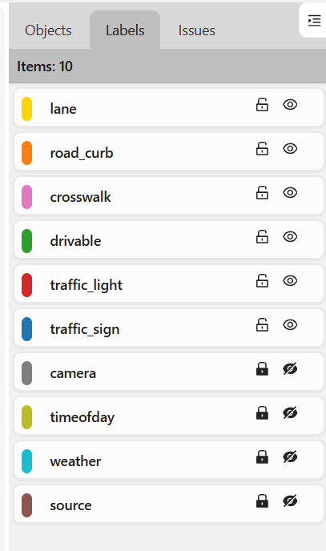
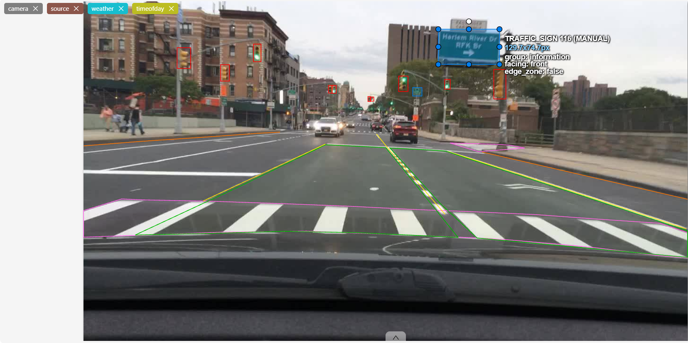
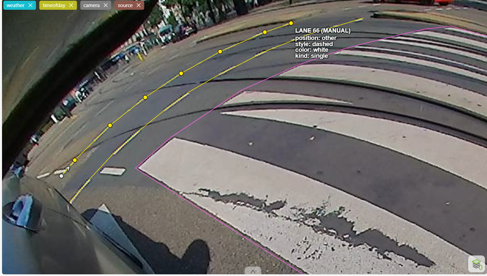
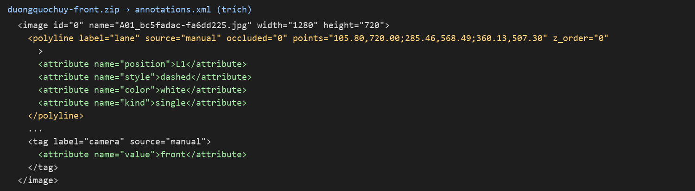

# Báo cáo cá nhân — Ngày 11

**File nộp (Google Drive):** [thư mục nộp bài](https://drive.google.com/drive/folders/17-svoc2UF6NHwtspMYVWMVJwXgsgqRK5?usp=drive_link), gồm `duongquochuy-front.zip`, `duongquochuy-fisheye.zip`, `duongquochuy-manifest.json`.

**Miễn QC1-02 (coach đã xem ảnh và xác nhận không thấy vạch):** A05 (L1, R1), A06 (L1, R1), A07 (L1), A09 (R1). Lint vẫn đếm 6 cảnh báo này trong `lint.nặng` của manifest.

Họ tên: Dương Quốc Huy               Mã học viên: 2A202603311  
Phiên bản CVAT (Help → About): __________  
Guideline: Road v1.0    Lần nộp (`revision` trong manifest): 2  
Thời điểm export (ngày giờ trên CVAT): 21/11/2026 11:32 (front và fisheye), giờ Việt Nam    Số lần nộp lại sau Rework: 1  

## 1. Kiểm project
| Mục | Đúng như guideline Road v1.0? | Ghi chú |
| --- | --- | --- |
| 6 label, đúng kiểu | Có | lane, road_curb (polyline); crosswalk, drivable (polygon); traffic_light, traffic_sign (rectangle). So với `python -m road_lab.taxonomy` ở Task 0 |
| Thuộc tính và giá trị | Có | Tên và giá trị khớp bảng ở guideline mục 1; `road_check lint` không báo QC1-12 (label hay giá trị lạ) |
| 4 tag ảnh | Có | camera, timeofday, weather, source; mỗi tag là label kiểu Tag có một thuộc tính select `value` |

Cách kết thúc polyline trên bản CVAT này: click lần lượt các điểm từ gần xe ra xa, bấm phím **N** để kết thúc; sau đó mở **Details** để sửa thuộc tính, vì polyline mới luôn mang mặc định `L1 / solid / white / single`.  
Cách đặt tag ảnh trên bản CVAT này: chọn công cụ **Tag** ở thanh bên trái, chọn label (`camera` trước tiên), rồi mở Details trong bảng Objects để chọn `value`, vì CVAT tự điền giá trị đầu danh sách.

## 2. Số lượng đã gán
| Task | Ảnh | lane | road_curb | crosswalk | drivable | traffic_light | traffic_sign |
| --- | ---: | ---: | ---: | ---: | ---: | ---: | ---: |
| front | 12 | 26 | 2 | 5 | 24 | 22 | 17 |
| front-extra (đã làm 0 / 4) | 0 | — | — | — | — | — | — |
| fisheye | 8 | 15 | 7 | 10 | 0 | 8 | 7 |
| fisheye-extra (đã làm 0 / 4) | 0 | — | — | — | — | — | — |

Nguồn: `duongquochuy-manifest.json` (revision 2, `shapes_by_label`). Mọi ảnh đều có đủ 4 tag (`images_all_tags` = 12 và 8), `contains_images` = false.

## 3. Bảng ca khó
| Ảnh | Nhãn | Phân vân giữa | Đã chọn | Lý do |
| --- | --- | --- | --- | --- |
| A01 | lane L2 (vạch trắng mép trái) | `kind = single` hay `double` | `double` | Mentor đã xem ảnh và xác nhận là vạch đôi |
| A05 | lane | Vẽ L1/R1 hay không | Không vẽ lane | Đường hẹp, hai bên là xe đỗ, mặt đường không có vạch sơn. Guideline: không vẽ vạch mà ảnh không có. Coach đã xác nhận không có vạch, miễn QC1-02 |
| A06 | lane | Lấy đoạn vạch vàng phía xa làm L1; hàng cột bên phải có tính là R1 không | Không vẽ lane | Vạch vàng chỉ thấy một đoạn ngắn sau vạch ngựa vằn; bên phải làn là hàng cột, không có vạch sơn. Coach đã xác nhận không có vạch, miễn QC1-02 |
| A07 | lane L1 | Bên trái làn là dải bê tông: vẽ L1 hay không | Không vẽ L1 | Không có vạch sơn dọc dải bê tông. Coach đã xác nhận, miễn QC1-02 |
| A08 | traffic_sign | `information` hay `prohibitory` cho tấm "PASSENGER CARS ONLY" phía trên biển chỉ đường | Theo chức năng: hạn chế loại xe | Tấm này nằm trên biển chính chứ không ở dưới như biển phụ thông thường; chọn theo chức năng như guideline hướng dẫn |
| A09 | lane | Vạch trắng đôi liền hay vạch đứt là ranh làn của xe | Chỉ vẽ vạch đứt làm L1 | Hai vạch hướng về hai điểm tụ khác nhau; vạch đứt đi theo hướng đường phía trước. Không thấy vạch R1; coach đã xác nhận, miễn QC1-02 |
| B03 | lane `position` | Camera sau: tính L/R theo hướng ảnh hay hướng xe chạy | L1, R1, R2 theo hướng ảnh | Guideline chỉ nói L1/R1/L2/R2 dùng cho fisheye_front và fisheye_rear, không nói hướng. Ghi lại để hỏi lead |
| B04, B06, B08 | drivable | Gán drivable cho ảnh fisheye không (B04 còn có làn BUS) | Không gán drivable ở lô fisheye | Đã hỏi coach: lô fisheye không yêu cầu drivable |

## 4. Phiếu QC 1 nhận được
Bạn kiểm lô của tôi: Đặng Trung Hiếu (mẫu A01–A06, 66 nhãn)  Quyết định nhận được: **Rework** (2 lỗi nặng, lỗi chính 2/66 = 3,0 %)  
| Mã lỗi | Số lỗi | Đồng ý? | Đã sửa? |
| --- | ---: | --- | --- |
| QC1-02 (A03: thiếu L1, vạch vàng liền bên trái làn) | 1 | Đồng ý | Đã sửa (revision 2): thêm L1 `solid / yellow / single` |
| QC1-03 (A03: vạch đứt bên phải làn ghi `L1`, đúng là `R1`) | 1 | Đồng ý | Đã sửa (revision 2): đổi thành `R1`; vạch đứt kế tiếp đổi thành `R2` |
| QC1-07 (A02: polygon `alternative` phủ lề bên phải vạch trắng liền) | 1 | Đồng ý | Đã sửa (revision 2): xóa polygon |
| QC1-09 (A01: biển xanh chỉ dẫn ghi `prohibitory`, đúng là `information`) | 1 | Đồng ý | Đã sửa (revision 2): cả 2 biển xanh đổi thành `information` |

Sửa thêm trong revision 2, ngoài phiếu: bật `edge_zone` cho biển ở B04 và B08, tắt `edge_zone` cho đèn ở B04; thêm điểm cho 4 lane fisheye chỉ có 3 điểm (B01, B02, B07, B08). Bản revision 1 (hai file zip và `duongquochuy-manifest-r1.json`) được giữ trong thư mục `r1/` trên máy. Lint revision 2: 0 cảnh báo chính, còn 6 cảnh báo QC1-02 ở các ảnh đã được coach miễn.

Trả lời các ca mơ hồ trong phiếu:
- A05, A06: coach đã xác nhận không có vạch, được miễn QC1-02.
- A03: polyline đang gán `R1` (sát hàng xe đỗ) là vạch đứt kế tiếp bên phải. Sau khi đổi vạch đứt sát xe thành `R1`, polyline này sẽ thành `R2`.
- A01: L2 là vạch đôi, mentor đã xác nhận. L1/R1 là hai dãy vạch đứt sát xe, R2 là vạch vàng mép phải.
- A03, A04 `timeofday`: đang chờ lead.

## 5. Kiểm file export
| File | Mở lại được? | Số shape ảnh 1 (job / file) | Số shape ảnh 2 (job / file) | Tag camera có trong XML? |
| --- | --- | --- | --- | --- |
| `duongquochuy-front.zip` | Có (`road_check lint` đọc được, CVAT for images 1.1) | A01: __ / 11 | A02: __ / 7 | Có (`front`, cả 12 ảnh) |
| `duongquochuy-fisheye.zip` | Có (`road_check lint` đọc được, CVAT for images 1.1) | B01: __ / 5 | B02: __ / 6 | Có, cả 8 ảnh (`fisheye_front` B01–B02, `fisheye_rear` B03–B04, `fisheye_left` B05–B06, `fisheye_right` B07–B08) |

Số shape trong file không tính 4 tag. Cột "job" đếm trên bảng Objects của CVAT.

## 6. Ảnh chụp màn hình
1. Tab Labels của project.  
   
2. Một ảnh camera trước đã gán đủ (làn, vùng lái, đèn/biển).  
   
3. Một ảnh fisheye đã gán, phóng to đoạn polyline cong.  
   
4. Một đoạn XML có <polyline label="lane">.  
   

## 7. Tự đánh giá
Lỗi bạn mắc nhiều nhất hôm nay (theo mã QC1-xx), và cách tránh ở Ngày 20:  
QC1-01, tag camera: ở lô fisheye tôi đặt `camera = front` cho cả 8 ảnh, vì CVAT tự điền giá trị đầu danh sách và tôi không mở Details để đổi. `lint` bắt được lỗi này từ tên file (FV/RV/MVL/MVR). Thứ hai là QC1-04 ở camera hai bên: có 5 polyline vẽ ngược chiều (điểm đầu cao hơn điểm cuối). Kéo theo đó, lane ở B05 để `position = L1` thay vì `other`; lint không bắt được vì tag camera đang sai. Tôi đã sửa cả ba lỗi trên CVAT trước khi export bản nộp. Ở Ngày 20 tôi sẽ: đặt tag camera đầu tiên và kiểm giá trị ngay trên ảnh đầu tiên của mỗi task; chạy `lint` sau khi xong mỗi task chứ không đợi cuối buổi; với camera bên thì luôn bắt đầu polyline từ đầu thấp hơn trong ảnh.

Nhãn của bạn đi vào model ở đâu? Chọn một lỗi đã sửa và nói nó làm model học sai thế nào:  
Tag camera dùng để chia dữ liệu theo camera: ảnh fisheye phải vào nhóm có mô hình méo ống kính và tham số camera riêng. Gán `front` cho ảnh fisheye thì ảnh méo cong bị đưa vào tập huấn luyện của camera trước. Model làn của camera trước học rằng vạch thẳng có thể cong như cung tròn, còn khi đánh giá theo từng camera thì số liệu của cả hai nhóm đều sai. Lỗi `position` (gọi vạch bên phải là L1) còn nguy hiểm hơn: model học sai đâu là ranh làn của chính xe, và chức năng giữ làn (LKA) sẽ căn xe theo nhầm làn.

## 8. (Tùy chọn, buffer) Từ polyline đến đích row-anchor
Ảnh A01, vạch R1, tính bằng `python -m road_lab.rowanchor <tên>-front.zip --image A01 --position R1`.

| y | 720 | 680 | 640 | 600 | 560 |
| --- | ---: | ---: | ---: | ---: | ---: |
| x của chúng tôi | không có làn | không có làn | 598,7 | 542,5 | 485,8 |
| x của bạn kia | không có làn | không có làn | 597,9 | 541,9 | 485,9 |

Trả lời 3 câu:

1. Năm số x đó chính là đích mà một model row-anchor học cho vạch này. Nếu bạn dừng polyline sớm 40 px, hàng nào đổi thành "không có làn"?  
   R1 của tôi đi từ y ≈ 680 lên tới y ≈ 513. Dừng sớm 40 px thì điểm cuối nằm ở khoảng y ≈ 553, vẫn qua hàng 560, nên **không hàng nào đổi**. Chỉ khi dừng sớm hơn khoảng 47 px (điểm cuối thấp hơn hàng 560) thì hàng **560** mới thành "không có làn". Khi đó model học rằng vạch biến mất sớm hơn thực tế, và tầm nhìn làn phía xa bị rút ngắn.
2. So với bạn được kiểm (cùng ảnh): ở hàng 720 và hàng 560, hai bạn lệch nhau bao nhiêu pixel? Lệch ở hàng nào ảnh hưởng LKA nhiều hơn (slide 25)?  
   Hàng 720: không so được, vì cả hai polyline đều bắt đầu ở khoảng y ≈ 680 (vệt đứt gần nhất), nên hàng này là "không có làn" ở cả hai bài. Hàng 560: lệch 0,1 px. Hàng 640: lệch 0,8 px. Lệch ở hàng gần xe (đáy ảnh) ảnh hưởng LKA nhiều hơn, vì LKA điều khiển theo vị trí ngang của vạch ngay trước xe. Một pixel ở hàng gần cũng ứng với khoảng cách ngoài đời lớn hơn so với một pixel ở hàng xa.
3. Nếu polyline vẽ từ xa về gần (ngược quy tắc 2), cách tính trên có đổi không? Script nào sẽ gặp khó?  
   Số x không đổi: nội suy tuyến tính theo hàng không phụ thuộc thứ tự điểm. Script gặp khó là `road_check`: nó coi điểm đầu là điểm gần xe, nên báo QC1-04 "vẽ ngược chiều" và so sai điểm đầu với điểm gần xe của GT. Bước nào lấy điểm đầu làm điểm neo gần xe cũng sẽ sai.
